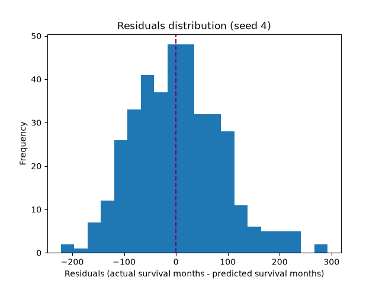
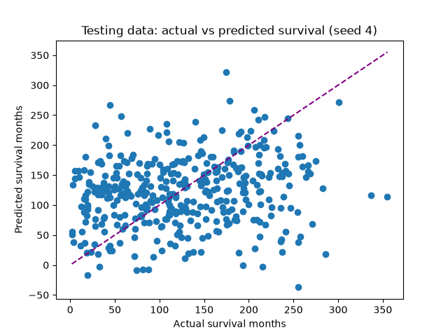
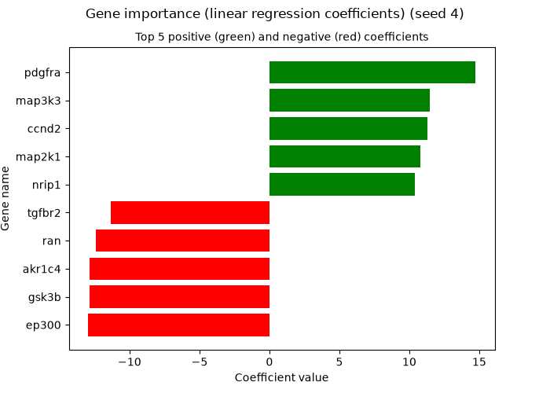
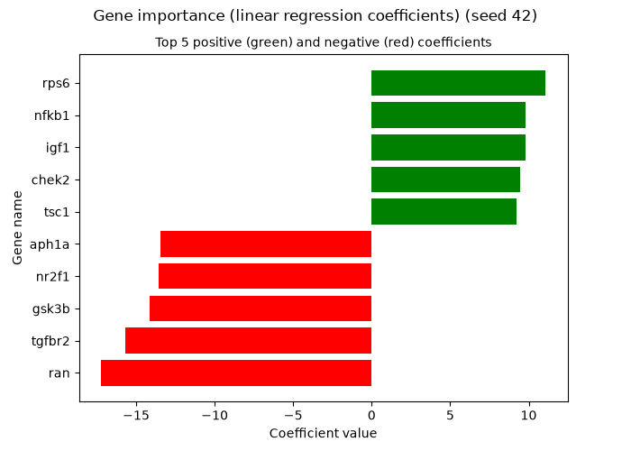

# Software Engineering for Scientists Homework 7

This repository contains code for analyzing the relationship between gene expression and overall survival in breast cancer patients.

## Installation and set up
First, open your Terminal and navigate to the directory that you want this repository to be located in. Then clone the repository by running
```
git clone https://github.com/maiakrd98/swe4s-homework-7.git
```

Next, navigate to the `swe4s-homework-7` folder by running 
```
cd swe4s-homework-7
```

Here, you will see all the files/folders in the repository.

To set up the environment, first run this code to create the environment:
```
mamba env create -f environment.yml
```
Then activate the environment by running
```
mamba activate swe4s-hw7
```

This environment contains `pycodestyle` for checking that python code is compliant with the PEP 8 style guide, `pandas` and `scikit-learn` for the analysis, and `matplotlib` for plotting.

Next, run
```
mkdir data
curl -L "https://drive.google.com/uc?export=download&id=1eCcqT58g8Of5svxiLxyArH_RIjuTs0LM" -o data/METABRIC_RNA_Mutation.csv
```
to import the required data file (which is not committed to the repository because it is too big).

## Data file information
`METABRIC_RNA_Mutation.csv` is a comma separated file with data on 1904 breast cancer patients, including various clinical information like survival months, age at diagnosis, and which treatments they received, m-RNA levels for 331 genes, and mutation information on 175 genes. See the [Kaggle website](https://www.kaggle.com/datasets/raghadalharbi/breast-cancer-gene-expression-profiles-metabric/data) where this data was originally published for more information on the various columns.

## Code function and testing instructions

`regression.py` takes five command line arguments: `--data_file`, `--out_folder`, `--seed`, `--gene_expr_start`, and `--gene_expr_end`. Using `scikit-learn` and the data in `data_file`, this script runs a linear regression to predict the overall survival months of breast cancer patients using their gene expression levels (listed between the `gene_expr_start` column and the `gene_expr_end` column). The training testing split uses the seed given in `seed`. The script also creates a histogram of the model residuals, a scatter plot of actual survival months vs predicted survival months for the testing data, and a plot of the top five positive and negative gene regression coefficients. The plot is saved to the folder given in `out_folder`.

Examples of running `regression.py` are in the following section.

## Fitting a regression model

### Introduction
We will look at the relationship between the expression of the genes in our dataset and the overall survival months of the patients. We hypothesize that gene expression will be able to predict overall survival months. The genes tracked in the dataset impact a variety of factors related to breast cancer that may affect patient survival.

### Results



The residuals have a wide range between -250 and 300 months. Given that the overall survival values are between zero and 356 months, the errors are nearly as large as the actual values, indicating that our model is not performing well. The residuals are at least roughly normally distributed around zero, indicating that our model is not biased.



The dashed purple line would be a perfect match between actual and predicted survival months. Our data is scattered widely and does not appear to follow that line. This is evidence that our hypothesis is not true. Gene expression cannot predict overall breast cancer survival, at least not via a simple linear regression.

 


These plots show the top 5 positive and negative regression coefficients and their corresponding genes. However, running the model with different seeds produces different top genes, so I don't think this really gives us any meaningful information.

### Methods

To analyze the data, I used the `LinearRegression` function from `scikit-learn` to fit a linear regression using the m-RNA expression levels of various genes to predict the overall survival months of breast cancer patients. I then created a histogram of the residuals and a scatter plot of actual vs predicted survival for the testing data. I also plotted the regression coefficients for the top 5 positive and negative genes. To generate the plots, run the following code, which first creates a directory for the plots for that seed. Note that this code should be run from the main directory of the repository.

```
mkdir plots_seed_4
```

```
python src/regression.py \
    --data_file "data/METABRIC_RNA_Mutation.csv" \
    --out_folder "plots_seed_4" \
    --seed 4 \
    --gene_expr_start "brca1" \
    --gene_expr_end "ugt2b7"
```

```
mkdir plots_seed_42
```

```
python src/regression.py \
    --data_file "data/METABRIC_RNA_Mutation.csv" \
    --out_folder "plots_seed_42" \
    --seed 42 \
    --gene_expr_start "brca1" \
    --gene_expr_end "ugt2b7"
```
